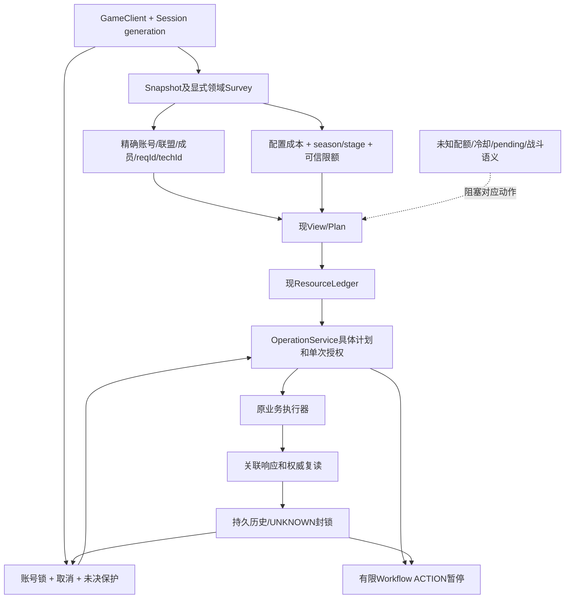

# PHASE 4 — Roadmap Reconciliation & System Integration

日期：2026-11-11。对账起点：codex/phase-3-advanced-gameplay@a50501910e8308771d3b6899cd4d48992e8c4012。本文是本轮权威增量；不改写原Master、原Inventory或历史验收。

## 1. 权威路线图与Git基线

原始权威：docs/baseline.md《Capability Mapping & Master Development Plan》V1.0，规划基线61ce3c0。原PHASE4第776行起明确为Alliance Platform、C301–C307。docs/ROADMAP_RECONCILIATION.md自标Planning Only，提出R1–R8/22工作包，属于参考建议，未获本轮替换原阶段授权。PHASE3 Delta与扩展任务也不能代替原Master。

已完整读取Master、PHASE1/2/3 Acceptance、PHASE2/3 Delta、PHASE2 Real E2E；Inventory 1–1419行由并行审计完整复读，无截断；以源码/测试复核结论。根目录和检查的适用父目录未发现AGENTS.md/TREE.md，不创建替代。历史PHASE3报告的Master Development Plan.md当前实际文件恢复为docs/baseline.md。三维表15,208字节、非空。

初始tracked/staged diff为空。main=61ce3c020ea8abedd9e70387c88528b6a8fe055b。PHASE1 da41d1c，PHASE2 972f81a/52b7824/9d97065，PHASE3从9d97065到a505019共14个本地提交，未推送：c22d3f7、7e147bc、e7f79e8、4b3fded、0db2187、3dbd4d6、378d975、19ba83a、7717e6b、09084fe、f0bd3eb、86b43ab、f300a35、a505019。

原未跟踪6份输入全部保留且不混入功能提交：CAPABILITY_INVENTORY.md、docs/baseline.md、docs/blueprint.md、docs/标准三维度拆分表单.md、docs/PHASE_2_REAL_E2E_ACCEPTANCE.md、docs/ROADMAP_RECONCILIATION.md。保留data/work/E2E，不读真实凭证、不连接游戏、不改代理/CA、不修改main、不reset/clean/强制覆盖、不推送。

PHASE3本轮可明确实施的离线功能完成，仍待Owner阶段验收。提前交付原PHASE4/5/6/8的部分能力，不等于这些原阶段通过。本轮已批准推进PHASE4，但未授权真实游戏写入。

## 2. 原Master全部阶段对账

状态口径：DONE仅指已说明范围的离线能力具备源码和测试；写功能缺真实/最终验收记PARTIAL。BLOCKED必须保留缺失的身份、成本或语义，不凭文档PASS认定功能。逐C账本在附录。

| 原阶段及目标 | 状态 | 当前源码/测试与差异 |
|---|---|---|
| 0 基线/Inventory/原表/C追踪 | DONE | main和历史祖先保留；原表非空；95个C编号见附录，原始输入未覆盖 |
| 1 CLI脱敏/凭证、资源预算、Action参数、D6、取消与未知保护 | DONE | cli-safety/actions/resource-ledger/execution/loop/tasks/client；cli-safety、actions-safety、resource-budget、execution-lifecycle、client-lifecycle测试；当前全回归包含原459项 |
| 2 建筑C101–104、生产C111–116、订单C121–128 | PARTIAL | city-operations/order-execution/production-policy/production-report/operation-service及对应测试；允许候选离线闭环已有，金币/免费刷新/完整全天量/真实写验收缺 |
| 3 阵容C207/211–214、战报C206–208、推荐C209/复制C215 | PARTIAL | formation/stages/stage-function及对应测试；保存/复读/推荐已有，极限站位复制未做；独立Stage长期历史未持久化 |
| 4 联盟C301–307 | PARTIAL | alliance与alliance.test已有精确身份和部分领取；帮助配额/求助冷却缺，科技尚未业务接入，本轮按原范围实施 |
| 5 舰队地图C401/403、编队C402、修理C407、加速C408、委托C406、监听跟随C404/405、动态决策C410、D6 C409 | PARTIAL | fleet/naval-facts/naval-rules及对应测试；编队/维修/友方移动已有；移动不是攻击，免费加速/宣战/持续监听跟随/动态攻击未闭环 |
| 6 博物馆C141–144、扫荡C151、钓鱼C152 | PARTIAL | museum与museum.test覆盖出发/展陈/收益；Complete/Reward缺pending身份；dailies DAILY_DRIVERS1010扫荡配额/权威结果缺；钓鱼生产Function未实现 |
| 7 日常活动C501–517、海商王C521–524 | PARTIAL | dailies/tasks/actions及对应旧测试有部分驱动/领奖；完整活动聚合/VIP/军备/海商王未接平台，参考实现不计完成 |
| 8 执行C601–603、记忆C604、顺序C605、历史C606、注册C607、可视图 | PARTIAL | business-functions/function-registry/workflow、gameplay-api/view/workflow测试；有限DAG已做，非全业务注册、无持久跨轮记忆/父预算/S5/S6/完整拖拽界面 |
| 9 全C/P/S/D集成及单功能真实验收 | NOT_STARTED | 此状态限定全平台release验收尚未启动；单进程OperationService集成子集和845测试不能替代全部能力、全部页面及真实验收 |

Pxxx：P0/P1现账号/Explorer与原始浏览可用；P2建设/生产/订单已接，港口/博物馆有通用业务页、扫荡/钓鱼缺专业闭环；P3阵容/战报已有，极限复制和英雄成长产品桥缺；P4当前JSON事实和配置，成员/科技专业视图本轮补；P5舰队页已有，委托/持续跟随/动态攻击缺，P5-3付费保持排除；P6活动聚合/贸易页未做；P7有限图/状态/历史存在但非全部业务和长期恢复；P8全局调度未做。证据：page/gameplay-page/server白名单与operations-view/gameplay-view/explorer-view/account-view测试。

S1手动/S2单次与现Stage S4已实现；S3缓存轮询不等于游戏轮询；S5通用定时、S6业务事件调度NOT_STARTED；S7有限图节点PARTIAL；S8订单/联盟/海战三值规则PARTIAL，无全平台通用规则引擎。D1–D9由现计划授权/Session锁/预算/取消/UNKNOWN/D6实现单进程受控子集；多进程owner和全legacy路径接入仍PARTIAL。

## 3. A–D事项账本

| 类别/事项 | 状态 | 源码/测试/验收证据与影响 |
|---|---|---|
| A1 PHASE2允许候选离线闭环，缺真实订单/升级/生产/写后复读/真实历史/UNKNOWN恢复验收 | PARTIAL | executeOrderOperation/executeCityAction及对应测试；Real E2E §C–G业务写0次，批准升级在新Survey ping timeout停，未到API授权/permit/run；不改写成业务成功或业务UNKNOWN |
| A2 PHASE3允许业务写Function最终验收 | PARTIAL | 六adapter和shared executor、236新增测试；离线交付待阶段验收，真实写未验证 |
| A3 有限DAG/逐ACTION新计划与单次授权 | DONE | workflow start/resume、workflow/gameplay-api测试；重启RECOVERED_STOPPED、resumable=false，不自动执行 |
| B1 联盟精确身份/成员/请求/可帮助项目/科技投影 | PARTIAL | allianceId/aidRow/GuildMember/alliance.test；科技当前只有game/data-catalog原始采集，需领域视图 |
| B2 科技成本/前置/season与stage | PARTIAL | 本地GuildTechPop/GuildTechUtil/WorldIdRule/SeasonTaskModel证据链；计划须绑定精确techId和下一等级，缺事实不写 |
| B3 互助可信每日次数/冷却/当地日预算来源 | BLOCKED | surveyAlliance.helpAllowance/helpUsage=null，allianceHelpRules；用户配置和工具局部历史不能伪造服务器总额度 |
| B4 自动求助阈值/数量/重复/冷却完整链 | BLOCKED | allianceView ASK_DAILY_LIMIT_UNKNOWN/ASK_COOLDOWN_UNKNOWN；无Ask候选、请求体和写后验证，缺可信冷却，不默认无限/免费 |
| C1 Museum Complete/Reward pending身份 | BLOCKED | museumView和museum测试明确阻断；两个动作独立，不盲领 |
| C2 Treasure抵达/战斗/掠夺/奖励 | BLOCKED | verifyTreasure仅以MyFleets绑定确认派遣，不证明战果/奖励 |
| C3 舰队加速/真实攻城/敌对移动成本 | BLOCKED | fleetView/verifyFleet及fleet/naval测试；未知几何或成本不派发；Move只是移动，LEFT只BT_MAINLINE |
| C4 持续玩家监听/自动跟随 | PARTIAL | surveyNaval只有WorldInfo当前视野和精确ID；无跨视野闭环 |
| C5 UNKNOWN权威复核/解除 | BLOCKED | history recover/unresolved和execution-history/gameplay-execution测试；以持久历史封锁整账号保护未决预算，但无可靠解除合同 |
| D1 跨进程连接/写owner、CLI委托或拒绝、NAS锁/CAS | NEEDS_OWNER_DECISION | server.sessions/connectionPromise及service锁在进程内，history同步read-modify-rename非跨进程锁；需选择唯一服务或租约方案 |
| D2 父工作流预算、持续委托、持久恢复/定时事件 | NEEDS_OWNER_DECISION | 当前每ACTION具体新计划/单批许可、每run独立Ledger；不把有限图扩成长期无限授权 |
| D3 历史阶段细分 | PARTIAL | service在executor预检前保守写DISPATCHING；可在原executor加onStage回调记录真实派发/响应/复读，持久化失败即停，无新执行器 |
| D4 R1–R8替代原PHASE0–9 | NEEDS_OWNER_DECISION | 新ROADMAP为Planning Only，不作为本轮范围扩大依据 |
| D5 presetId是整队、Move是攻击、watch resolve是成功、人工确认解除D6等旧解释 | SUPERSEDED | 原Master/formation/verify/assertPaymentAllowed明确否定；保留原资料但不沿用错误解释 |

## 4. 依赖图及运行条件

独立运行条件：Formation、City/Order允许候选、Museum已知子动作、Fleet已知维修/编队/移动、Treasure无争夺派舰具备独立离线合同；均需READY、身份/成本可靠和具体单次授权。Naval当前独立只读/规则。跨域组合：阵容→VERIFY→有限Stage；订单缺口→生产；联盟/舰队通过有限图复用已注册Function。组合不能补业务语义。

需要持续任务：玩家监听/跟随/委托、跨批生产/求助、S5/S6；当前一次Survey/有限DAG不等于持续闭环。需要跨进程保留：计划/授权/派发不确定/预算/验证/图停止证据；当前已持久操作和图历史但不恢复执行，独立Stage/Loop历史与持久冷却尚缺。

## 5. 公共集成审查

| 公共能力 | 状态 | 源码/测试及实质边界 |
|---|---|---|
| GameClient关联、迟到、未知指纹 | DONE | client request/sendWatch/lateResponses/uncertainWrites；client-lifecycle/client-unverified-write/gameplay-execution；传输结果不当业务成功 |
| Session唯一连接/隔离 | PARTIAL | server:91/163/239及server-runtime，同进程single-flight/generation保护；第二服务或CLI可另建Client，无全局owner |
| 同账号写互斥/不同账号并行 | DONE | service acquire/server refresh与stage门控，operation-service/gameplay-locks；限定单服务进程 |
| ResourceLedger | PARTIAL | reserve/validateResources与resource-budget测试；同批共享、不因旧余额补回；UNKNOWN以持久历史封锁整账号保护，不是可自动释放分项账本；DAG跨节点无父预算 |
| OperationService | DONE | plan/lookup/authorize/execute精确绑定account/generation/client/config/rules/hash/budget/有效期/单次permit；API同源CSRF/精确账号，不接任意协议 |
| ExecutionHistory/恢复 | PARTIAL | wx/fsync/rename和corrupt fail closed；unfinished→UNKNOWN且不重发；无跨进程CAS，预检与真正派发粒度尚粗 |
| Lifecycle取消/断线/旧owner | DONE | execution/client/stages与gameplay-execution/stages-formation/gameplay-locks；已发后取消UNKNOWN、旧finally不释放新锁 |
| Workflow | PARTIAL | workflow 50节点/100边/200步/WAIT≤60s、无JS/循环；ACTION仅plan，SUCCESS+CONFIRMED历史才resume；未全legacy注册，无长期恢复 |
| Snapshot/Explorer | DONE | game48查询唯一/data-catalog27解析21原始；snapshot-precision/data-safety/explorer测试；缓存不发实时查询 |
| API/UI | PARTIAL | 窄gameplay/operations/workflows复用原门控；gameplay-api/view；六页多为JSON事实，原P0–P8未全部闭合，legacy写仍READ_ONLY_ROUTE |

重复状态审查：六模块只用executeBusinessOperation；orders/city保留世界适配，没有重建Client/Session/48目录。Snapshot缓存与新鲜领域Survey需明确时效，不能各自冒充长期权威。旧CLI/Loop未全部通过OperationService持久阻断，是集成范围缺口。

问题分类：功能实现（科技/钓鱼/贸易）、协议证据（加速/返回身份）、业务语义（派遣≠攻城/领奖）、预算（跨run/次数）、执行可靠性（跨进程owner/UNKNOWN复核）、UI（专业列表/科技树/拖拽）。不得以UI或抽象掩盖缺语义。

## 6. PHASE4实施顺序、复用与验收

完整目标延续原4.1–4.4：请求/精确成员/物品/每日额度/科技只读；按ID/物品/数量帮助计划与授权复读；自动求助阈值/重复/冷却/次数；科技目标等级/成本/升级复读。追加本任务全路线图对齐与公共审查。证据缺失的分支保留BLOCKED，未扩至原PHASE5–9全量开发。

| 顺序 | 直接复用 | 真正新增/扩展 | 离线验收/真实依赖 |
|---|---|---|---|
| 4.0 对齐/基线 | 原Master/Inventory/现源/测试 | 本文，不造替代Master | 14提交、原输入保留、845+29基线；无真实依赖 |
| 4.1 联盟科技 | surveyAlliance/allianceView/planAlliance/verifyAlliance、ResourceLedger、shared executor、GuildTechInfo | 科技投影、成本/解锁、精确单级目标、typed+新读确认 | codec正常/缺失/重复/成本未知/余额不足/身份变化/UNKNOWN/取消/超时；真实服务端扣点需另批 |
| 4.2 联盟专业展示 | 现gameplay/operations窄路由、账号guard、参数/候选/授权 | 成员/请求/限额/科技表、选择参数和成本 | API账号/CSRF、UI精确ID/迟到/阻断/草稿、实际adapter授权复读；无新执行器 |
| 4.3 历史证据细分 | 原onStage/service/history/business executor | 记录预检/派发/关联响应/复读/最终，存储失败即停，保留原持久屏障 | 派发前存储失败0写、派发后失败UNKNOWN、重启不重发、原回归；真实时序需另批 |
| 4.4 回归/文档/提交 | 原845 tests+29selftest | 更新本文交付结果及README | 保留所有原测试，新增与全回归通过、diff检查、显式staging、无data/work/凭证 |

科技本地客户端证据：GuildTechPop:1525、GuildTechUtil:1527、GuildModel:1473、WorldIdRule:3603、SeasonTaskModel:2821、LoginProxy:1925，静态main game.js哈希a6046fcc2ad7a3424282e9f8b51073656f5ae8d48742129743560bf958266c54。科技Upgrade只有techId，不把目标等级塞进协议；目标由前态level+1和新读确认。真实season来自Session player.worldId，stage来自SeasonTaskStageResponse.stage，不接调用者伪造。

互助缺可信限额/冷却不解禁；DonateFort独立堡垒建设，不是任意成员转物；帮助每reqId一件不包装成任意数量转账。科技reset不在原4.4，不扩展。D6继续硬拒。D1/D2/D4需要未来Owner架构决定，不阻塞本轮既有单进程、单批、离线科技适配和历史细分。

## 7. 执行结果（实施后更新）

初始回归：隔离CW_DATA_DIR，node src/selftest.mjs与node --test：29组、845/845通过，0失败/取消/skip。素材检查按原条件跳过，未下载。日志TEMP/cw-phase4-offline/baseline-selftest.log、baseline-regression.log。此时完成路线图对齐，尚未改产品代码；之后创建PHASE4独立分支。

## 附录：95项原Cxxx起点账本

下面依据现有源码重新核对，沿用ROADMAP报告的需求名称和证据索引，状态转换为本任务指定口径；其R/W阶段号不继承。源码路径相对仓库，Function名是后续行号变化时的定位依据。科技最终实施结果在第7节更新，不隐式覆盖起点。

| C ID | 原目标 | 状态 | 源码证据 | 实际边界/缺口 |
|---|---|---|---|---|
| C001 | 凭证→Session 建立 | PARTIAL | accounts.mjs:loadStore/upsertAccount; server.mjs:91/237 newSession/connect | Session建立存在，扫码产品入口仍隐藏/禁止 |
| C002 | 账号隔离 | DONE | server.mjs:91/115/163; accounts.mjs | 账号Session/配置/快照隔离存在；跨进程所有者见本文§3 D1 |
| C003 | 世界/区服切换 | PARTIAL | worlds.mjs:68 enterWorld; app.mjs:139 | CLI进入存在；Web enter在白名单前被拒；任意worldId可能创建角色 |
| C004 | 状态采集（只读） | DONE | game.mjs:7/98/131 ENTRY_QUERIES/collectState/summarize | 48基础查询，27解析21原始，不新建清单 |
| C005 | 协议调用（通用） | DONE | client.mjs:211/266; proto.mjs:44; codec.mjs:15 | 通用传输内部可复用；不开放任意HTTP请求 |
| C101 | 建筑信息读取 | DONE | world.mjs:86 surveyWorld; city-operations.mjs:38/131 | 建筑信息与业务页面已有 |
| C102 | 建筑升级前置校验 | DONE | world.mjs:209 planWorld; city-operations.mjs:167 | 材料/等级/人口/队列前检已有；未知不计划 |
| C103 | 建筑升级执行 | PARTIAL | city-operations.mjs:221 executeCityAction; world.mjs:469 | 升级授权与权威复读已有，真实未验 |
| C104 | 建造执行 | PARTIAL | city-operations.mjs:167/221; actions.mjs BuildBuilding | 仅服务端已有level0槽；不是任意地图新坐标建造 |
| C111 | 工厂状态读取 | DONE | surveyCityOperations/cityView; world.mjs:86 | 工厂/队列/空位/成品可靠性已有 |
| C112 | 生产报表聚合 | PARTIAL | production-report.mjs:36 summarizeProductionHistory | 仅工具确认事件，完整全天产量null；需完整事件覆盖或Owner缩减口径 |
| C113 | 库存缺口计算 | DONE | production-policy.mjs:61 productionShortages | 合并订单需求扣库存/在产/成品；UNKNOWN不作零 |
| C114 | 自动生产决策 | PARTIAL | production-policy.mjs:101 selectProductionCandidates; planWorld | 本批策略已有，持续轮询属于调度缺口 |
| C115 | 生产提交执行 | PARTIAL | executeCityAction/runWorld StartFactoryProduce | 启动/即时完成复读已有 |
| C116 | 成品收取/竣工 | PARTIAL | executeCityAction GainFactoryProduce/CollectBuildingProduct/FinishUpgradeBuilding | 数量双证据确认；真实未验 |
| C121 | 居民需求读取 | DONE | order-execution.mjs:92 surveyOrderExecution; surveyWorld | 需求源OnWater，缺数组不是权威空 |
| C122 | 需求物品解析 | DONE | decorateOrderSurvey; world.mjs:86; resourceCosts | 物品ID/安全数量解析已有 |
| C123 | 订单库存缺口 | DONE | evaluateOrders; planOrderExecution; ResourceLedger | 跨订单预算分配已有，不把独立模拟当批量预留 |
| C124 | 订单奖励计算 | BLOCKED | surveyWorld rewardExp; order-rules.mjs:113 | EXP存在，金币/MIN_GOLD可靠来源缺失 |
| C125 | 订单规则评估 | DONE | order-rules.mjs validateOrderRules/evaluateOrder/evaluateOrders | 五类规则/优先级/解释轨迹已有 |
| C126 | 订单提交执行 | PARTIAL | order-execution.mjs:104/146 planOrderExecution/executeOrderOperation | SUBMIT闭环已有；免费REFRESH proof生产缺失 |
| C127 | 规则持久化 | DONE | order-rules-store.mjs loadOrderRules/saveOrderRules | 精确账号原子保存及坏文件保护已有 |
| C128 | 执行历史记录 | PARTIAL | execution-history.mjs:16; operation-service.mjs:256 | 订单持久历史存在；恢复解除见本文§3 C5 |
| C131 | 港口货物读取 | DONE | fleet.mjs:18/134 surveyFleet/fleetView | CargoShips读取和通用Fleet展示已有 |
| C132 | 港口缺货识别 | PARTIAL | fleet.mjs:119/141 buildCandidates/planFleet | 成本/余额阻断有；required/have/missing明细与高亮缺 |
| C133 | 提交货物执行 | PARTIAL | fleet.mjs:127/194 cargoFill/verifyFleet | FillCargoShip typed+精确货格filled复读已有 |
| C134 | 领取港口奖励 | PARTIAL | fleet.mjs:129/198 cargoClaim/verifyFleet | 到港状态消费+奖励回包已有；E2E加库存核对 |
| C141 | 寻宝状态读取 | DONE | museum.mjs:40/58 surveyMuseum/museumView | 探索次数/进度/状态可读，COMPLETE_UNSETTLED独立 |
| C142 | 寻宝缺货识别 | PARTIAL | museum.mjs:61/93/175 | 成本/库存线阻断有，missing明细未形成 |
| C143 | 冒险寻宝执行 | PARTIAL | museum.mjs:95/188 MuseumStartExplore/verifyMuseum | 出发和道具加速Function存在，结算领奖另计C144 |
| C144 | 领取寻宝奖励 | BLOCKED | museum.mjs:74 blocked; proto MuseumCompleteExplore/MuseumReward | 两个动作独立，缺可恢复pending身份，不可用收益代替 |
| C151 | 海面扫荡 | PARTIAL | dailies.mjs:376 DAILY_DRIVERS[1010] | PirateSweep执行有，权威次数/配额检查和复读缺 |
| C152 | 钓鱼 | BLOCKED | proto StartFishing/StartFishingResponse/GainBigFish/DrawFishReward | 无生产调用链；FishEncyclopedia只是图鉴 |
| C201 | 当前关卡读取 | DONE | stages.mjs:114 createStageRunner; server.mjs stageView | mainlineStage当前读取已有 |
| C202 | 挑战关卡执行 | PARTIAL | stages.mjs createStageRunner/parseStageResult | ChallengeStage执行已有，保持主线专属证据 |
| C203 | 战斗结果解析 | DONE | stages.mjs:85 parseStageResult/resolveMainlineChallengeSide | 严格关卡/Boolean/BT_MAINLINE/LEFT已有 |
| C204 | 关卡循环控制 | PARTIAL | stages.mjs:114 createStageRunner | 顺序长任务/可取消等待/最大尝试和目标已有 |
| C205 | 限频处理 | DONE | stages.mjs stageError; execution.mjs executionOutcome | RATE_LIMITED独立停止；原表等待重试被D8安全修订取代 |
| C206 | 敌方阵容抓取 | DONE | formation.mjs:180/198 battleAnalysis | 消费已有rightTeams，不额外挑战取数据 |
| C207 | 我方阵容抓取 | DONE | formation.mjs:180/198; surveyFormation | 实际leftTeam与当前GetFormation来源分开 |
| C208 | 战斗结果分析 | PARTIAL | formation.mjs:198 battleAnalysis; stages.mjs:255 | 伤害/存活/战败保守分析存在；长期比较依赖后续战报聚合与Owner范围确认 |
| C209 | 自动换阵决策 | PARTIAL | formation.mjs:234 recommendFormations | 只有CLIENT_CAREER_LAYOUT推荐，automatic:false；无自动保存续跑闭环 |
| C211 | 当前阵容查询 | DONE | formation.mjs:98/154 surveyFormation/viewFormation | 主线当前阵容独立读，petUid精度保留 |
| C212 | 已解锁阵型查询 | DONE | formation.mjs:69/98 catalogFrom/surveyFormation | 解锁布局列表存在，preset不是整队存档 |
| C213 | 阵容保存/切换前置校验 | DONE | formation.mjs:52/69/120 validateFormationParameters/candidate | 归属/人数/职业/站位/宠物校验已有 |
| C214 | 阵容保存/切换执行 | PARTIAL | formation.mjs:161/170 planFormation/verifyFormation | SaveFormation typed与GetFormation全量一致才确认 |
| C215 | 一键复制"极限通关"站位 | NOT_STARTED | formation.mjs:234仅职业重排；无极限复制算法 | 定义源战报/敌我英雄映射/缺人/坐标变换再实现 |
| C221 | 角色升级前置校验 | DONE | heroes.mjs:39/66 maxHeroLevelFor/planHeroes | 成长等级和材料前检已有，复用Ledger |
| C222 | 角色升级执行 | PARTIAL | heroes.mjs:221/275 runHeroPlan/sendHero | 等级CLI写存在，sendWatch后UNKNOWN；缺权威Hero复读/API/UI/History |
| C223 | 角色升星前置校验/执行 | PARTIAL | heroes.mjs:221/282 HeroStarUp | typed回复直接SUCCESS，缺权威复读和产品桥 |
| C224 | 技能升级前置校验/执行 | PARTIAL | heroes.mjs:56/221/275 skillLevelMinStar/runHeroPlan | 技能预算/星级校验有，缺执行后权威确认与产品桥 |
| C225 | 专武等级前置校验/执行 | NOT_STARTED | proto HeroExclusiveLevelUp; reference heroGrow.mjs:629 | 目标无专武成长Function，先提取参考成本算法 |
| C226 | 专武星级前置校验/执行 | NOT_STARTED | proto HeroExclusiveStarUp/HeroExclusiveNextUpResponse; ref heroGrow | 目标无业务，Response不能按同名猜造 |
| C227 | 纹章替换前置校验/执行 | NOT_STARTED | proto BadgeReplace/PutOnBadge; ref heroGrow.mjs:629 | 纹章实例替换未接目标，H确认与唯一UID预留必须 |
| C228 | 纹章升级前置校验/执行 | NOT_STARTED | proto EnhanceBadge; ref heroGrow planBadgeEnhance | 纹章升级目标无业务，复用参考校验而非预算器 |
| C229 | 装备升级前置校验/执行 | NOT_STARTED | proto EnhanceEquip; ref heroGrow/equip | 装备升级目标无业务，材料与实例身份复读必需 |
| C230 | 装备替换前置校验/执行 | NOT_STARTED | proto EquipReplace/PutOnEquip; ref heroGrow | 装备替换目标无业务，不自动分解/不可逆扩域 |
| C301 | 联盟求助单识别 | DONE | alliance.mjs:84/99 surveyAlliance/allianceView | reqId精确绑定成员求助单，已有展示 |
| C302 | 联盟成员识别 | DONE | alliance.mjs:92 titleList.members | 成员ID识别已实现，专业列表UI可改进 |
| C303 | 按成员捐赠前置校验/执行 | BLOCKED | alliance.mjs:36/96/113 allianceHelpRules | 规则与help构造有，当前生产Survey的helpAllowance/helpUsage=null，缺可信额度/全日用量而保持阻断 |
| C304 | 按物品捐赠前置校验/执行 | BLOCKED | allianceHelpRules/planAlliance; alliance.mjs:52 | 共用按itemIds规则，不建第二捐赠器；配额证据缺 |
| C305 | 自动求助前置校验/执行 | BLOCKED | alliance.mjs:120 ASK_COOLDOWN_UNKNOWN | 配置/协议有，无ask body/执行复读，阈值/日限/冷却缺 |
| C306 | 联盟科技状态读取 | PARTIAL | game.mjs:34 GuildTechInfo; data-catalog.mjs:48 | 原始只读存在，科技树UI未实现 |
| C307 | 联盟科技升级前置校验/执行 | NOT_STARTED | proto UpgradeGuildTechRequest/Response | 无业务适配；补前置/成本/权限/目标等级/复读 |
| C401 | 舰队编组读取 | DONE | fleet.mjs:18/24/134 | MyFleets+OnWater队伍读取已有，不用MyFleets代替阵容复读 |
| C402 | 舰队编组修改前置校验/执行 | PARTIAL | fleet.mjs:97/105/165 FleetSaveFormation | 无非零宠物范围编组可执行；非零宠物绑定证据另列受限分支 |
| C403 | 地图目标读取 | DONE | naval-rules.mjs:52/69 surveyNaval/navalView; world.mjs地图 | 当前WorldInfo城市/玩家/舰队和资源田可读；非全地图 |
| C404 | 目标监听 | PARTIAL | naval-rules.mjs:67/87 observations | 单次观察/规则有，有限持续监听/事件游标缺 |
| C405 | 跟随指定玩家 | BLOCKED | naval-rules.mjs:42/75/91 | 仅精确玩家前置观察规则有；跟随执行无候选，跨视野稳定定位/事件流缺 |
| C406 | 攻击派遣前置校验/执行 | BLOCKED | fleet.mjs:56/114/190 movementCost/fleetMove | 仅独立fleetMove移动子能力已实现；攻击派遣零候选，宣战/胜负/权限语义缺 |
| C407 | 修船前置校验/执行 | PARTIAL | fleet.mjs:38/72/88/141/181 | 维修阈值/单价/计划汽油上限/优先级/停止已有 |
| C408 | 加速前置校验/执行 | BLOCKED | fleet.mjs:134 blocked SpeedUpFleet/Repair/Cargo | 无D6允许的道具加速候选；不能用RUBY补齐 |
| C409 | 钻石使用规则评估 | DONE | actions.mjs:277 assertPaymentAllowed | D6统一硬拒绝已实现；正向钻石消费EXCLUDE |
| C410 | 动态攻击决策 | BLOCKED | naval-rules.mjs:10/94 evaluateNavalRules/planNaval | 仅三值前置观察规则有；动态攻击选择与授权派遣无候选 |
| C501 | 活动识别 | PARTIAL | game.mjs Snapshot Week/Season; data-catalog | 有活动数据，无完整活动身份/开放状态聚合 |
| C502 | 活动任务读取 | PARTIAL | dailies.mjs:421 surveyDailies; tasks.mjs:63 surveyTasks | 部分任务读取，不能当全部周/季活动任务 |
| C503 | 活动任务执行前置校验/执行 | PARTIAL | dailies.mjs:539 runDailies; tasks.mjs:190 runTasks | 部分日常驱动/领奖存在，活动全量和Operation桥缺 |
| C511 | 邮件领取 | PARTIAL | actions.mjs emailQuickGet; app.mjs loot | 仅已读附件QuickGotReadEmail，静默UNKNOWN，未读/复读/UI链缺 |
| C512 | VIP 礼包领取 | NOT_STARTED | proto GotVipDailyRewardRequest | 无生产调用，月卡权益不等于VIP礼包 |
| C513 | 商城礼包领取（日/周） | PARTIAL | dailies.mjs:135/583 planDailyGift/claimDailies | 免费日赠礼已复读；原需求免费周礼包未全 |
| C514 | 周活动补给礼包领取 | BLOCKED | proto WeekLotteryFreePack/WeekChipGotFree等候选 | 缺具体周补给身份/资格契约，不按名称混认 |
| C515 | 周活动每日任务执行 | PARTIAL | game.mjs WeekInfo/WeekOrderInfo; DrawWeeklyReward | 周状态/周活跃不等于活动每日任务闭环 |
| C516 | 周活动奖励领取 | PARTIAL | dailies.mjs:81/611 planChests | 周活跃箱已有，活动奖励语义未全 |
| C517 | 军备竞赛奖励领取 | BLOCKED | proto Season/Ranking/活动候选；无军备业务映射 | 须识别活动ID/领取档位/资格与权威复读来源 |
| C521 | 海商王价格读取 | PARTIAL | dailies.mjs:340 TradeInfo probe | 原始TradeInfo可读，价格/商品/港口业务模型缺 |
| C522 | 低买高卖预期计算 | NOT_STARTED | reference tradeKing.mjs:585 planBuy仅参考 | 目标无收益算法；先移植只读模型和可靠卖点 |
| C523 | 自动买卖前置校验/执行 | NOT_STARTED | proto TradeBuy/TradeSellRequest/Response; ref planTradeKing | 无目标买卖适配；商会币需专用成本语义，不能全局放开Buy |
| C524 | 自动巡航 | NOT_STARTED | proto TradeMove/TradeSpeedRequest/Response; reference tradeKing | 无目标巡航；仅已证实非钻石路径可用 |
| C601 | 只读探测（每轮首步） | DONE | workflow.mjs:136; operation-service.mjs:92 surveyModule | 现有SURVEY可用，复用基础Snapshot，不建第二collector |
| C602 | 计划生成 | PARTIAL | operation-service.mjs:103; workflow.mjs:137 | 计划合同存在，orders/city/production/heroes等未全注册 |
| C603 | 动作执行（单条/整轮） | PARTIAL | business-functions.mjs:12 executeBusinessOperation; OperationService | 共用执行有，旧执行链未全适配 |
| C604 | 跨轮记忆 | PARTIAL | loop.mjs:15/102 rejected; tasks/dailies rejected参数 | 仅进程内跨轮记忆，持久冷却/拒绝/日界缺 |
| C605 | 顺序执行引擎 | DONE | workflow.mjs:110 createWorkflowRunner | 有限DAG顺序执行已实现；S5/S6是独立调度缺口 |
| C606 | 运行状态/历史查询 | PARTIAL | operation-service.mjs:256; workflow.mjs:206/235 | 已有持久操作/图历史，Standalone Stage/旧Loop未全接与关联字段缺 |
| C607 | Function 注册表 | PARTIAL | function-registry.mjs:9/10; server.mjs:132/133 | 6玩法+stage，缺完整目录/schema/C-P-S/授权/取消/验证元数据 |
