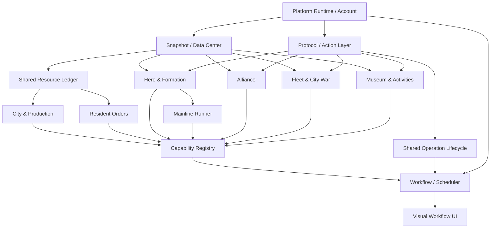

# CrazyWater Platform — Capability Mapping & Master Development Plan

版本：V1.0  
规划基线：2026-11-10  
开发仓库：`\\zhangnas\app\crazywaterword`  
Git Baseline：`61ce3c020ea8abedd9e70387c88528b6a8fe055b`  
参考仓库：`C:\Users\zyk-o\Documents\crazywaterword`  
参考 HEAD：`6c2825a4d7dda17bf894b45744d2fd39e6a05499`

本文件基于：

1. 用户确认的标准三维度需求表。
2. 已完成的 `CAPABILITY_INVENTORY.md`。
3. 当前项目真实源码、Function、API、UI、协议、测试及参考仓库实现。

本文件只负责需求映射、模块归并及开发规划，不直接修改源码。

---

# PART 1 — 规划原则与状态定义

## 1.1 三维度关系

| 维度 | 标识 | 解决的问题 |
|---|---|---|
| 业务能力 | Cxxx | 系统能做什么 |
| UI 形态 | Pxxx | 用户如何配置、观察和操作 |
| 调度方式 | Sx | 能力何时运行、如何重复和组合 |
| 全局约束 | D1-D9 | 所有业务必须遵守的执行规则 |

三维度必须保持独立。

通过 Cxxx 关联 UI 和 Scheduler。

例如：

`C204 → P3-1 → S4`

表示主线循环控制由自动闯关页面配置，交给长时任务调度器执行。

## 1.2 开发处理类型

| 类型 | 含义 |
|---|---|
| DIRECT | 直接复用现有 Function |
| ADAPT | 复用现有 Function，增加适配、验证或 API/UI |
| COMPOSE | 组合多个现有 Function |
| NEW | 确认不存在，需要新开发 |
| DISCOVER | 已有协议或参考实现，需要先补齐业务语义 |
| EXCLUDE | 当前产品约束明确不允许实现 |

能力状态以 Inventory 为准，不继承需求表原先的 EXISTING、待核或新增标签。

---

# PART 2 — Cxxx 全量需求映射

## A0 平台底座

| C ID | 需求 | Inventory 映射 | 处理方式 | 开发结论 |
|---|---|---|---|---|
| C001 | 凭证→Session | PLT-007/008/009/022 | ADAPT | 保留安全凭证导入、登录和 Session 建立；补产品化扫码入口 |
| C002 | 账号隔离 | PLT-002~006/013/014 | DIRECT | 不重写；继续复用账号、Session、配置和 Snapshot 隔离 |
| C003 | 世界/区服切换 | PLT-017/018 | ADAPT | 复用 worlds.mjs；补显式授权 UI/API，不能将进入新区当只读查询 |
| C004 | 状态采集 | PLT-015/016、DEX-001~009 | DIRECT | 继续使用 48 项 Snapshot，不建立第二份采集清单 |
| C005 | 通用协议调用 | PLT-012/030/031 | DIRECT | 复用 GameClient、Protocol、Codec 和请求关联；不开放任意请求 Web API |

## A1 基地经营

| C ID | 需求 | Inventory 映射 | 处理方式 | 开发结论 |
|---|---|---|---|---|
| C101 | 建筑信息读取 | DAT-017、BIZ-W01 | DIRECT | 复用 OnWater 与 surveyWorld |
| C102 | 建筑升级前置校验 | BIZ-W07/W11 | ADAPT | 复用 planWorld；先修多候选材料超额预留 |
| C103 | 建筑升级 | BIZ-A22、BIZ-W07 | DIRECT | 复用 upgradeBuilding/runWorld |
| C104 | 建造 | BIZ-A23、BIZ-W07 | DIRECT | 复用 buildBuilding/runWorld |
| C111 | 工厂状态读取 | DAT-017、BIZ-W01 | DIRECT | 复用 OnWater 工厂队列解析 |
| C112 | 生产报表聚合 | 无对应完整能力 | NEW | 新增本地统计计算，不增加游戏协议 |
| C113 | 库存缺口计算 | BIZ-W02/W03/W10 | DIRECT | 复用现有库存 Map 和需求解析 |
| C114 | 自动生产决策 | BIZ-W10 | DIRECT | 复用 planWorld |
| C115 | 生产提交执行 | BIZ-A21、BIZ-W10 | DIRECT | 复用 startProduce |
| C116 | 成品收取/竣工 | BIZ-A04/A06、BIZ-W06/W07 | DIRECT | 复用已有收取及竣工 Action |
| C121 | 居民需求读取 | DAT-017、ORD-001 | DIRECT | 复用 OnWater.workerOrder |
| C122 | 需求物品解析 | ORD-002 | DIRECT | 复用 surveyWorld |
| C123 | 订单库存缺口 | ORD-003 | DIRECT | 复用现有库存和 missing 计算 |
| C124 | 订单奖励计算 | ORD-004/005/006 | ADAPT | EXP 直接复用；金币需要可靠来源后补充 |
| C125 | 订单规则评估 | ORD-007~017 | DIRECT | 复用 order-rules.mjs |
| C126 | 订单提交执行 | BIZ-A19/A20、ORD-021 | COMPOSE | 将新 Rule Engine 接入旧 finishOrder/rerollOrder |
| C127 | 规则持久化 | ORD-018 | DIRECT | 复用 order-rules-store |
| C128 | 执行历史 | ORD-022 | ADAPT | 复用现有执行结果，补账号级持久化记录 |
| C131 | 港口货物读取 | DAT-019、BIZ-D08、参考 R04 | ADAPT | 复用 CargoShips 和 TradeInfo 线索 |
| C132 | 港口缺货识别 | 参考 BIZ-R04 | ADAPT | 移植参考 planCargo 计算 |
| C133 | 提交港口货物 | PRO-004、参考 BIZ-R04 | ADAPT | 复用 FillCargoShipRequest/Response |
| C134 | 领取港口奖励 | PRO-004、参考 BIZ-R04 | ADAPT | 复用 DrawShipRewardRequest/Response |
| C141 | 博物馆寻宝状态读取 | BIZ-D15、PRO-006 | ADAPT | 复用 MuseumInfo 探测，补业务解析 |
| C142 | 寻宝缺货识别 | 无目标 Function | NEW | 本地资源需求计算 |
| C143 | 冒险寻宝执行 | PRO-006 | DISCOVER | 复用 MuseumStartExplore 等协议，先还原完整业务流程 |
| C144 | 领取寻宝奖励 | PRO-006 | DISCOVER | 复用 MuseumCompleteExplore/MuseumReward 等消息 |
| C151 | 海面扫荡 | BIZ-D10、参考 BIZ-R03 | ADAPT | 复用 PirateSweep，补次数与配额检查 |
| C152 | 钓鱼 | DAT-018、相关协议线索 | DISCOVER | 鱼类图鉴不等于钓鱼执行；先检查客户端完整调用链 |

## A2 成长与战斗

| C ID | 需求 | Inventory 映射 | 处理方式 | 开发结论 |
|---|---|---|---|---|
| C201 | 当前关卡读取 | STG-001 | DIRECT | 复用 PlayerInfo.mainlineStage |
| C202 | 挑战关卡执行 | STG-001 | DIRECT | 复用 ChallengeStage |
| C203 | 战斗结果解析 | STG-002/003 | DIRECT | 复用严格 LEFT 与 isLeftWin 判断 |
| C204 | 关卡循环控制 | STG-004~015 | DIRECT | 复用现有 Stage Runner |
| C205 | 限频处理 | STG-011 | DIRECT | RATE_LIMITED 独立停止，不当作普通战败重试 |
| C206 | 敌方阵容抓取 | ChallengeStageResponse.initialData.rightTeams | ADAPT | 从真实战斗响应提取，不重复请求战斗 |
| C207 | 我方阵容抓取 | FRM-001、战斗响应 initialData.leftTeam | ADAPT | 统一实际战斗阵容和当前阵容数据模型 |
| C208 | 战斗结果分析 | 无专门分析 Function | NEW | 根据敌我阵容、伤害和胜负生成报告 |
| C209 | 自动换阵决策 | 无 | NEW | 基于战斗分析和规则生成阵容方案 |
| C211 | 当前阵容查询 | FRM-001 | DIRECT | 复用 GetFormation |
| C212 | 已解锁阵型查询 | FRM-002 | DIRECT | 复用 MyFormationPreset |
| C213 | 阵容保存/切换校验 | FRM-003/004 客户端证据 | ADAPT | 复用客户端合法站位与人数规则 |
| C214 | 阵容保存/切换执行 | FRM-003/004 | ADAPT | 新增最小 SaveFormation Function/API/UI |
| C215 | 复制极限通关站位 | FRM-007/008 | NEW | 新增阵容映射与站位转换算法 |
| C221 | 角色升级前置校验 | BIZ-H01 | DIRECT | 复用 planHeroes 的等级和材料判断 |
| C222 | 角色升级 | BIZ-H02 | DIRECT | 复用 runHeroPlan |
| C223 | 角色升星 | BIZ-H03 | DIRECT | 复用现有英雄升级链 |
| C224 | 技能升级 | BIZ-H04 | DIRECT | 复用技能规划与执行 |
| C225 | 专武等级 | BIZ-H05、参考 BIZ-R09 | ADAPT | 优先移植 heroGrow |
| C226 | 专武星级 | BIZ-H05、参考 BIZ-R09 | ADAPT | 优先移植 heroGrow |
| C227 | 纹章替换 | BIZ-H05、参考 BIZ-R09 | ADAPT | 补资源和人工确认 |
| C228 | 纹章升级 | BIZ-H05、参考 BIZ-R09 | ADAPT | 复用参考实现 |
| C229 | 装备升级 | BIZ-H05、参考 BIZ-R09 | ADAPT | 复用参考实现 |
| C230 | 装备替换 | BIZ-H05、参考 BIZ-R09 | ADAPT | 补不可逆操作确认 |

注意：

C207 与 C211 应共享底层阵容解析，但保留语义区别：

- C207：战斗实际参与阵容。
- C211：当前阵容查询接口返回值。

不得因为共用 GetFormation 而丢失战斗时的真实阵容证据。

## A3 联盟与社交

| C ID | 需求 | Inventory 映射 | 处理方式 | 开发结论 |
|---|---|---|---|---|
| C301 | 联盟求助单识别 | BIZ-D13、PRO-002 | ADAPT | 复用 GuildAidList 探测，补完整展示 |
| C302 | 联盟成员识别 | DAT 公会数据、PRO-002 | DISCOVER | 确认成员 ID 和成员资料字段 |
| C303 | 按成员捐赠 | PRO-002 | DISCOVER | 确认 GuildAidHelp/GotMyGuildAid 等真实业务语义 |
| C304 | 按物品捐赠 | PRO-002 | DISCOVER | 与 C303 共享底层捐赠执行适配器 |
| C305 | 自动求助 | PRO-002 | DISCOVER | 复用 GuildAidAskRequest，补物品阈值与次数判断 |
| C306 | 联盟科技读取 | DAT-GuildTechInfo | DIRECT | 复用现有查询和原始响应 |
| C307 | 联盟科技升级 | PRO-001 | ADAPT | 复用 UpgradeGuildTechRequest/Response |

注意：

C303、C304 不应因为 DonateFortRequest 存在就认定协议已经确认。必须根据实际客户端调用位置区分联盟互助捐赠与堡垒捐赠。

## A4 世界舰队与海战

| C ID | 需求 | Inventory 映射 | 处理方式 | 开发结论 |
|---|---|---|---|---|
| C401 | 舰队编组读取 | DAT-MyFleets | DIRECT | 复用 MyFleets Snapshot |
| C402 | 舰队编组修改 | PRO-003 FleetSaveFormation | DISCOVER | 研究完整参数和保存语义 |
| C403 | 地图目标读取 | BIZ-W14、DAT-MyResFields、RadarInfo | ADAPT | 复用地图资源和雷达读取 |
| C404 | 目标监听 | 参考 watch-check.py、BIZ-R02 | NEW | 建立目标状态监控 |
| C405 | 跟随指定玩家 | 参考 watch-check.py | NEW | 基于玩家 ID 生成位置观察任务 |
| C406 | 攻击派遣 | PRO-003、BIZ-R12 | DISCOVER | 区分移动到城市与真正攻击/宣战 |
| C407 | 修船 | PRO-003 RepairFleet、BIZ-R02/R12 | ADAPT | 复用维修逻辑和耐久校验 |
| C408 | 加速 | PRO-003 SpeedUpFleet/SpeedUpRepair | ADAPT | 仅使用允许的加速道具 |
| C409 | 钻石规则 | D6 | EXCLUDE | 当前不构建钻石消费功能，统一拒绝 |
| C410 | 动态攻击决策 | 无 | NEW | 依赖 C403-C408 完成后再开发 |

## A5 活动与日常

| C ID | 需求 | Inventory 映射 | 处理方式 | 开发结论 |
|---|---|---|---|---|
| C501 | 活动识别 | 48 项 Snapshot、DAT 赛季活动数据 | ADAPT | 建立活动聚合展示 |
| C502 | 活动任务读取 | BIZ-D01、DAT 任务/活动 | DIRECT | 复用现有任务调查 |
| C503 | 活动任务执行 | BIZ-D17/18、27 ACTIONS、参考 BIZ-R17 | ADAPT | 先接现有 Action，再移植特定活动 |
| C511 | 邮件领取 | BIZ-A11 | DIRECT | 复用 emailQuickGet |
| C512 | VIP 礼包领取 | BIZ-A15 等 | DISCOVER | 不把月卡每日奖励当成 VIP 礼包 |
| C513 | 免费商城礼包领取 | BIZ-A14/A15 | DIRECT | 仅免费赠礼与已有权益 |
| C514 | 周活动补给领取 | 相关活动协议、参考模块 | DISCOVER | 确认具体活动与礼包类型 |
| C515 | 周活动每日任务 | BIZ-D17、WeekInfo/WeekOrderInfo | ADAPT | 复用日常任务框架，补周活动驱动 |
| C516 | 周活动奖励 | BIZ-A13、BIZ-D18 | ADAPT | 区分周活跃宝箱和活动奖励 |
| C517 | 军备竞赛奖励 | DAT 赛季/排名数据、相关协议 | DISCOVER | 补真实领取链 |
| C521 | 海商王价格读取 | BIZ-D08 TradeInfo、参考 BIZ-R13 | ADAPT | 复用价格数据 |
| C522 | 低买高卖计算 | 参考 BIZ-R13 | ADAPT | 复用 tradeKing planBuy |
| C523 | 自动买卖 | PRO-008、参考 BIZ-R13 | ADAPT | 复用 TradeBuy/TradeSell |
| C524 | 自动巡航 | PRO-008、参考 BIZ-R13 | ADAPT | 复用 TradeMove/TradeSpeed |

## A6 编排层

| C ID | 需求 | Inventory 映射 | 处理方式 | 开发结论 |
|---|---|---|---|---|
| C601 | 只读探测 | DEX-001、BIZ-W01、BIZ-D01 | DIRECT/ADAPT | 保留各业务 survey，不建重复采集器 |
| C602 | 计划生成 | planWorld、planHeroes、surveyTasks、OrderRules | COMPOSE | 逐步统一计划输入输出契约 |
| C603 | 动作执行 | 27 ACTIONS、runWorld、runHeroPlan、runDailies、runTasks | COMPOSE | 复用执行器，不创建第二套请求构造 |
| C604 | 跨轮记忆 | BIZ-L03、BIZ-D24 | ADAPT | 增加账号级拒绝/冷却记录 |
| C605 | 顺序执行引擎 | BIZ-L03、STG Runner | ADAPT | 复用顺序调度，补统一执行上下文 |
| C606 | 运行状态/历史 | BIZ-L04、PLT-021 | ADAPT | 复用 Stage/Loop 状态，增加持久运行账本 |
| C607 | Function 注册表 | PLT-043 NOT_FOUND | NEW | 建立静态能力目录，供工作流画布选择节点 |

---

# PART 3 — 模块归并（Module Consolidation）

## 3.1 最终模块结构

不按照 95 个 Cxxx 建立 95 个独立模块。

建议归并为以下业务模块：

| 模块 | 包含能力 | 主要复用来源 |
|---|---|---|
| M0 Platform Runtime | C001-C005 | PLT-001~031 |
| M1 Data Center | C004、C101、C111、C121、C201、C301、C401、C501 等只读能力 | DEX、DAT |
| M2 City & Production | C101-C116 | actions、world |
| M3 Resident Orders | C121-C128 | order-rules、world、actions |
| M4 Port & Trade Cargo | C131-C134 | tradePort 参考模块 |
| M5 Museum & Exploration | C141-C144 | Museum 协议族 |
| M6 Sea Sweep & Fishing | C151-C152 | dailies、相关协议 |
| M7 Hero Growth | C221-C230 | heroes、heroGrow |
| M8 Formation & Battle Analysis | C206-C215 | stages、heroes、formation 客户端算法 |
| M9 Mainline Automation | C201-C205 | stages |
| M10 Alliance | C301-C307 | GuildAid、guildOrder、guildPack |
| M11 Fleet & City War | C401-C410 | radar、pirate、cityWar、guildShip |
| M12 Activities & Dailies | C501-C517 | dailies、tasks、youdu、idle |
| M13 Trade King | C521-C524 | tradeKing |
| M14 Workflow & Scheduler | C601-C607 | loop、stages、各业务模块 |
| M15 Shared Execution Services | 所有业务共用 | Session、Action、预算、历史、取消 |

## 3.2 必须共享的底层能力

### A. AccountRuntime

统一复用：

- Session
- GameClient
- accountId
- generation
- activeTask
- AbortSignal
- 请求关联
- 账号状态
- 连接失效清理

不得为联盟、海战、博物馆分别创建独立登录系统。

### B. Snapshot / Data Access

统一复用：

- collectState
- session.snapshot
- DATA_CATALOG
- summarize
- exploreSnapshot
- cachedClient

业务模块不允许重复定义已经存在的48项基础查询。

额外查询必须登记实际用途和参数，不能把只读探针与 Snapshot 基础采集混在一起。

### C. Shared Resource Ledger

这是当前最值得抽取的共享业务能力。

统一处理：

- 资源数量
- 道具数量
- 订单需求
- 配方需求
- 舰队维修材料
- 活动道具
- 预留数量
- 可用余额
- 执行后剩余预算

解决当前 planWorld 和 OrderRules 各自独立模拟库存的问题。

同一批计划不得重复使用同一份材料。

### D. Shared Action Layer

复用：

- ACTIONS
- buildBody
- assertAllowed
- runAction
- GameClient.request
- GameClient.sendWatch

每个业务模块声明自己的允许 Action，不允许开放通用任意 Request/Action API。

### E. Shared Operation Lifecycle

统一业务执行过程：

`SURVEY → PLAN → VALIDATE → AUTHORIZE → EXECUTE → VERIFY → RECORD`

每一步有明确结果。

不能将 sendWatch 在短窗口内没有观察到拒绝当成服务端最终成功。

结果分类：

- SUCCESS
- FAILED
- RATE_LIMITED
- REJECTED
- UNKNOWN
- CANCELLED
- NOT_EXECUTED

UNKNOWN 不能被当成失败后盲目重试。

### F. Shared Rule Evaluation

当前 OrderRules 是居民订单专用规则引擎。

先保留其专用性。

后续在订单、联盟、海战至少出现两个以上真实规则使用场景后，再抽取：

- 优先级
- 条件
- 比较操作符
- FAIL / PASS / UNKNOWN
- KEEP / REFRESH / REVIEW
- 规则解释轨迹

不先建一个空的通用 Rule Engine。

### G. Shared Scheduler

统一处理：

- 账号级运行锁
- 顺序执行
- 运行 ID
- 停止
- 超时
- 延时
- 断线取消
- 账号删除取消
- 未决请求保护
- 运行历史

保留 Stage Runner 的成熟取消逻辑，不把旧 loop 的弱取消机制直接复制为新调度标准。

不同账号可以独立并行；同一账号的游戏写操作串行。

---

# PART 4 — Pxxx 页面与功能归并

| UI ID | 页面 | 当前状态 | 实施方案 |
|---|---|---|---|
| P0-1 | 账号列表 | EXISTING_UI | 保留，补扫码捕获产品入口 |
| P0-2 | 账号配置 | PARTIAL | 从订单规则扩展账号独立业务配置 |
| P1-1 | 数据中心总览 | EXISTING_UI | 保留 |
| P1-2 | 建筑生产 | PARTIAL | 增加独立建筑/生产报表 |
| P1-3 | 英雄阵容 | PARTIAL | 补实际阵容视图 |
| P1-4 | 舰队地图 | PARTIAL | 复用 Explorer，逐步增加业务地图 |
| P1-5 | 活动联盟 | DATA_ONLY | 增加领域展示 |
| P1-6 | 原始响应浏览器 | EXISTING_UI | 保留48项、27解析、21原始 |
| P2-1 | 建筑管理 | NOT_FOUND UI | 新增 |
| P2-2 | 资源生产 | PARTIAL | 复用 planWorld |
| P2-3 | 居民规则编辑 | EXISTING_UI | 保留 |
| P2-4 | 居民订单预览 | EXISTING_UI | 保留 |
| P2-5 | 居民执行 | NOT_FOUND UI/API | 新增执行桥接与页面 |
| P2-6 | 贸易港口 | NOT_FOUND UI | 复用 tradePort |
| P2-7 | 博物馆寻宝 | NOT_FOUND UI | 新增业务页 |
| P2-8 | 海面扫荡 | PARTIAL | 复用 PirateSweep |
| P2-9 | 钓鱼 | NOT_FOUND UI | 先发现真实调用链 |
| P3-1 | 主线闯关 | EXISTING_UI | 保留 |
| P3-2 | 阵容对比 | PARTIAL | 提取真实战斗阵容 |
| P3-3 | 战斗分析 | NOT_FOUND UI | 新增 |
| P3-4 | 自动换阵 | NOT_FOUND | 新增规则决策 |
| P3-5 | 阵容管理 | NOT_FOUND UI | 新增保存、切换和验证 |
| P3-6 | 英雄列表 | EXISTING_UI | 保留 |
| P3-7 | 英雄操作 | PARTIAL | 复用 CLI Function，补 UI/API |
| P4-1 | 联盟成员与求助 | PARTIAL | 补成员和求助详情 |
| P4-2 | 捐赠配置 | NOT_FOUND UI | 新增 |
| P4-3 | 自动求助配置 | NOT_FOUND UI | 新增 |
| P4-4 | 联盟科技 | DATA_ONLY | 补科技页面 |
| P5-1 | 舰队编组 | DATA_ONLY | 补编队读写 |
| P5-2 | 城战委托 | NOT_FOUND UI | 新增 |
| P5-3 | 钻石规则 | EXCLUDE | 当前禁止钻石消费 |
| P5-4 | 监听跟随 | NOT_FOUND UI | 新增 |
| P5-5 | 动态决策 | NOT_FOUND | 后置开发 |
| P6-1 | 活动列表 | DATA_ONLY | 增加活动聚合 |
| P6-2 | 日常清单 | PARTIAL | 复用现有日常执行 Function |
| P6-3 | 海商王 | NOT_FOUND UI | 移植 tradeKing |
| P7-1 | 可视化工作流 | NOT_FOUND | 后期开发 |
| P7-2 | 运行面板 | PARTIAL | 统一显示不同 Runner |
| P7-3 | 历史日志 | PARTIAL | 增加持久历史 |
| P8-1 | 账号默认配置 | PARTIAL | 扩展账号独立配置 |
| P8-2 | 敏感操作确认 | PARTIAL | 建立统一授权策略 |
| P8-3 | 全局调度 | NOT_FOUND | 后期开发 |

页面数量不等于模块数量。

一个页面可以引用多个 Cxxx，一个 Cxxx 也可以被多个页面引用。

---

# PART 5 — S1-S8 调度映射与实现边界

| Scheduler | 类型 | 当前实现 | 后续方案 |
|---|---|---|---|
| S1 | 手动 | 账号、Stage 启动、CLI 操作 | 保留，所有敏感操作均可人工发起 |
| S2 | 单次 | 27 Actions、CLI业务命令 | 统一操作结果与验证 |
| S3 | 轮询 | UI缓存轮询、业务调查 | 区分缓存轮询与真正游戏请求轮询 |
| S4 | 长时任务 | Stage Runner | 直接复用 |
| S5 | 定时 | 无通用定时调度器 | 后续增加日/周调度 |
| S6 | 事件 | WebSocket事件、SSE日志 | 先识别真实游戏业务事件来源 |
| S7 | 工作流节点 | 未实现 | 后续可视化编排 |
| S8 | 条件驱动 | OrderRules、planWorld局部判断 | 逐步抽取共享规则语义 |

重要区别：

- 前端3秒读取缓存，不等于3秒向游戏发送48项请求。
- Stage Runner 是长时任务，不是通用工作流。
- OrderRules 是业务专用规则引擎，不是全平台 Rules Engine。
- `runLoop` 是固定循环，不是可视化工作流。

---

# PART 6 — 全局执行约束 D1-D9

所有业务模块必须执行。

| ID | 约束 | 实施要求 |
|---|---|---|
| D1 | 先探测，再计划，再执行 | 无计划时不发游戏写请求 |
| D2 | 写操作显式授权 | API、UI、CLI 各自必须经过明确授权 |
| D3 | 顺序执行 | 同一账号写操作串行；不同账号允许独立并行 |
| D4 | 敏感操作人工确认 | 纹章、装备、派遣等按操作风险分类 |
| D5 | 材料不足不补钻石 | 资源不足直接跳过 |
| D6 | 禁止钻石和付费礼包 | 禁止 testAccount/superToken；钻石操作一律拒绝 |
| D7 | Session 级隔离 | 同一账号使用同一写操作锁 |
| D8 | 未知结果不盲目重试 | UNKNOWN、超时、断线和限频单独处理 |
| D9 | 状态不可靠不执行 | 数据过期、缺失或校验失败时停止对应操作 |

D4 与 D6 的关系：

D6 是当前硬约束，优先于 D4。

人工确认不能使当前禁止的钻石消费变成允许操作。

---

# PART 7 — Master Development Plan

按依赖关系分为九个阶段。

不得跨阶段绕过前置模块。

## PHASE 0 — Baseline & Capability Mapping

状态：规划基线已建立，能力 Inventory 已完成。

任务：

- 保留当前 Git Baseline。
- 保留三维需求表。
- 建立本文件作为 Master Plan。
- 后续所有功能通过 Cxxx 追踪。

验收：

- 当前主分支基线不被重置。
- 原始 E2E 证据不被覆盖。
- 新开发任务可以定位到 Cxxx。

## PHASE 1 — Shared Execution Safety & Existing Defect Closure

优先级：P0。

目的：在重新开放更多写操作之前，修复已确认的公共执行问题。

### 1.1 CLI 与凭证安全

复用 PLT-019/029、PLT-022。

任务：

- 统一 CLI 输出脱敏。
- 限制 accounts show 的秘密展示。
- 检查 headless/state/act 输出。
- 迁移旧 probe 到安全账号来源。
- 保持真实凭证只在明确授权路径中读取。
- 不重新设计 Token 采集链。

验收：

- 合成 Token/Sign/Cookie 不出现在普通输出。
- Web 与 CLI 的脱敏测试分开通过。
- 原始登录帧不会进入普通运行日志。

### 1.2 资源预算正确性

修复：

- planWorld 多订单库存重复使用。
- 多建筑升级候选超额预留。
- 新订单规则与旧 world 计划共享同一库存事实。
- 生产、订单、英雄和后续海战使用同一套资源预算语义。

验收：

- 两张订单各需要2件材料、库存只有2件时，只能计划一张。
- 两座建筑各需2件材料、库存只有2件时，只能计划一座。
- 多个计划组合不能超过可用余额。
- 执行前再次校验余额。

### 1.3 Action 参数修复

修复：

- buildingCollect 的 repeated string 参数。
- challengeField 缺少舰队时的 undefined 字符串问题。
- 所有 repeated 字段必须有正确数组形态。

验收：

- 每个受影响 Request 通过真实 Protobuf encode/decode。
- 标量与数组输入得到确定且正确的结果。

### 1.4 付费边界

重点修复 DiscountShopBuy 的 paid 判定。

不能因为 status=ready 就认为允许购买。

要求：

- allowPaid 未开启时，所有付费或成本未知的动作拒绝。
- D6 下付费礼包和钻石消费始终拒绝。
- 规则、配置和服务器状态必须共同校验。

### 1.5 运行生命周期

复用 PLT-010/012/013、Stage Runner。

修复：

- runLoop 取消延迟不及时。
- runTasks 跨轮 rejected 记忆丢失。
- sendWatch 短窗口成功误判。
- 旧循环缺少逐步骤取消。
- 运行结束和未知结果清理。

验收：

- 停止后不继续下一步。
- 未决请求不被重新发送。
- 断线后不自动恢复写操作。
- UNKNOWN 不作为 FAILED 重试。

阶段完成后，不自动开放所有 Web 写 API。

---

## PHASE 2 — City & Production + Resident Order Automation

优先级：P1。

这是最适合先形成完整产品体验的阶段。

### 2.1 建筑管理

能力：

C101、C102、C103、C104。

复用：

- surveyWorld
- planWorld
- upgradeBuilding
- buildBuilding
- FinishUpgradeBuilding

新增：

- 建筑升级前置校验展示。
- 不可升级原因。
- 建造位置选择。
- 资源预算展示。
- 单次执行授权。

UI：P2-1。

### 2.2 资源与生产

能力：

C111-C116。

复用：

- OnWater
- AllItem
- AllResource
- BuildingProduceCfg
- planWorld
- runWorld

新增：

- 当日生产报表。
- 生产缺口汇总。
- 工厂空位与队列展示。
- 自动生产规则配置。
- 生产执行历史。

UI：P2-2。

### 2.3 居民订单执行闭环

能力：

C121-C128。

保留：

- order-rules.mjs
- order-rules-store.mjs
- previewOrderRules
- evaluateOrders
- finishOrder
- rerollOrder

新增一个小型执行适配器，不重写订单规则引擎。

推荐流程：

1. 获取当前 Snapshot。
2. 读取四个居民订单。
3. 解析需求、经验和库存。
4. 使用 Rule Engine 评估。
5. 进行跨订单库存预留。
6. 生成 KEEP/REFRESH/REVIEW/SUBMIT 计划。
7. 展示本轮计划。
8. 获取明确执行授权。
9. 对每个订单重新验证当前状态。
10. 满足条件才提交或刷新。
11. 收到结果后复查。
12. 记录历史。
13. 状态未知则停止该订单及相关后续动作。

必须区分：

- REFRESH 是决策结果，不是已经发送刷新请求。
- SUBMIT 是建议结果，不是已经成功提交。
- 订单刷新后必须重新评估，不能直接沿用旧决策。

新增 UI：P2-5。

保留 P2-3/P2-4。

验收：

- 规则编辑与模拟不产生游戏写请求。
- REFRESH 只消耗允许的刷新次数。
- SUBMIT 前重新验证库存。
- 同批多个订单不会超额消耗。
- UNKNOWN 不会自动重复提交。
- 执行历史与预览轨迹分离。

---

## PHASE 3 — Formation & Battle Intelligence

优先级：P2。

### 3.1 阵容管理

能力：

C207、C211-C214。

复用：

- GetFormationRequest
- MyFormationPresetRequest
- SaveFormationRequest
- 客户端 FormationBase.switchPresetFormation
- FormationTypePositionCfg
- FormationTypeUnlockCfg

新增：

- 当前阵容结构解析。
- 阵型模板可用性检查。
- 站位合法性验证。
- 英雄职业排序。
- 站位映射。
- petUid 保留。
- SaveFormation Function。
- SaveFormation API。
- 阵容管理 UI。

必须区分：

presetId 是阵型模板，不是完整英雄队伍。

不能只修改 presetId 就认为切换成功。

保存后必须复读阵容验证。

不得自动解锁阵型模板。

### 3.2 战斗分析

能力：

C206-C208。

复用：

ChallengeStageResponse.initialData：

- leftTeam
- rightTeams
- leftPlayer
- rightPlayer（允许缺失）
- BattleStats
- leftHeroDamages
- rightHeroDamages

新增：

- 实际参战阵容保存。
- 敌我站位比较。
- 战斗伤害统计。
- 存活情况。
- 战败原因分类。
- 关卡历史对比。

不新增额外挑战请求来获取已经存在的战斗数据。

### 3.3 自动换阵

能力：

C209、C215。

流程：

战斗失败
→ 分析报告
→ 规则判断
→ 生成候选阵容
→ 用户确认或规则授权
→ 阵容保存
→ 复读验证
→ Stage Runner 继续。

首版先实现推荐阵容，不默认自动换阵。

验收：

- 不改变其他战斗模式的 SIDE_UNVERIFIED 规则。
- 主线阵容应用完成后才允许继续挑战。
- 旧阵容和新阵容都可以还原。
- 未经授权不改变阵容。

UI：P3-2 至 P3-5。

---

## PHASE 4 — Alliance Platform

优先级：P3。

能力：

C301-C307。

### 4.1 联盟只读能力

先完成：

- 求助单列表。
- 成员 ID。
- 成员状态。
- 可捐赠项目。
- 个人每日上限。
- 联盟科技。

复用：

- GuildAidListRequest
- MyGuildAidRequest
- AllGuildAbstraction
- GuildOrder
- GuildTechInfo
- 参考 guildOrder

### 4.2 按 ID 捐赠

新增：

- 指定成员 ID。
- 指定物品。
- 指定数量。
- 可用库存检查。
- 每日额度检查。
- 捐赠计划。
- 单次确认。
- 结果复核。

协议选择必须由真实客户端业务链确定，不能仅凭 DonateFortRequest 名称认定它就是目标互助接口。

### 4.3 自动求助

新增规则：

- 指定物品。
- 最低库存。
- 最大求助数量。
- 每日次数。
- 已有求助是否重复。
- 请求冷却。

执行：

读取状态 → 判断缺口 → 检查次数 → 生成计划 → 授权 → 请求 → 验证。

### 4.4 联盟科技

复用 UpgradeGuildTechRequest。

新增目标等级、材料和资源预检查。

UI：P4-1 至 P4-4。

验收：

- 成员 ID 精确匹配。
- 不会对错误成员捐赠。
- 不超库存和每日上限。
- 不重复求助。
- 未知请求结果不自动重试。

---

## PHASE 5 — Fleet & City War Platform

优先级：P4。

这是复杂度最高的业务模块之一。

不要一开始就开发动态攻击。

### 5.1 舰队与地图读取

能力：

C401、C403。

复用：

- MyFleets
- MyResFields
- RadarInfo
- AllPirate
- 参考 radar
- 参考 pirate
- 参考 cityWar

新增统一展示：

- 舰队 ID。
- 耐久。
- 当前任务。
- 空闲状态。
- 当前位置。
- 目标城市。
- 可用维修资源。

### 5.2 舰队编组

能力：

C402。

复用 FleetSaveFormationRequest 的客户端调用证据。

先完成只读编组，再开发保存。

### 5.3 维修

能力：

C407。

复用：

- RepairFleet
- FleetRepairParam
- StopRepairing

规则：

- 耐久阈值。
- 是否正在维修。
- 是否有足够维修材料。
- 是否有其他委托冲突。

只允许普通维修，不允许钻石维修。

### 5.4 加速

能力：

C408。

复用：

- SpeedUpFleet
- SpeedUpRepair
- 可用加速道具

规则：

- 剩余时间阈值。
- 加速道具数量。
- 加速后目标剩余时间。

未知加速成本直接拒绝。

### 5.5 城战委托

能力：

C406。

先明确：

- MoveFleetsToCity 是移动还是攻击。
- DeclareWar 是否必须。
- 是否需要联盟权限。
- 目标城市是否有保护时间。
- 舰队是否空闲。
- 汽油消耗。
- 失败后的状态。

然后构建委托状态机：

PRECHECK → AUTHORIZE → DISPATCH → MONITOR → COMPLETE/ERROR。

### 5.6 监听和跟随

能力：

C404、C405。

实现：

- 指定玩家 ID。
- 目标状态轮询。
- 位置变化记录。
- 目标消失。
- 跟随条件。
- 停止条件。

如果游戏没有可用推送，则使用受控轮询，不假设存在实时位置事件。

### 5.7 动态攻击决策

能力：

C410。

必须依赖 C403-C408。

第一版规则：

- 目标类型白名单。
- 目标玩家 ID。
- 目标城市。
- 最低战力条件。
- 舰队耐久阈值。
- 汽油预算。
- 最大同时委托数量。
- 避免重复攻击。
- 失败后停止条件。

动态攻击决策先输出计划。

派遣仍需独立授权。

UI：P5-1、P5-2、P5-4、P5-5。

P5-3 钻石规则保持禁用。

---

## PHASE 6 — Museum, Exploration & Secondary Activities

优先级：P5。

### 6.1 博物馆

能力：

C141-C144。

先研究 MuseumInfo 和 PRO-006。

明确：

- 探索次数。
- 可用次数。
- 探索条件。
- 奖励。
- 进度。
- 是否需要消耗道具。
- 是否有免费加速。
- 是否存在不可逆操作。

复用 MuseumStartExplore、MuseumCompleteExplore、MuseumReward 等消息。

注意：

Museum 与 TreasureLoot 是两种不同玩法。

不得把世界宝藏货轮抢占当作博物馆寻宝。

### 6.2 海面扫荡

C151。

复用 PirateSweep 和参考 pirate。

修复次数/配额判断后接入页面。

### 6.3 钓鱼

C152。

先恢复真实客户端调用链。

不要仅凭 FishEncyclopedia 推断钓鱼执行流程。

UI：P2-7、P2-8、P2-9。

---

## PHASE 7 — Daily, Activities & Trade King

优先级：P6。

### 7.1 日常

C501-C517。

复用：

- surveyDailies
- runDailies
- claimDailies
- surveyTasks
- runTasks
- 27 ACTIONS

补充参考：

- idle
- guildPack
- youdu

不要把每个日常拆成独立 Runner。

### 7.2 海商王

C521-C524。

复用：

- TradeInfo
- TradeGuildRadar
- TradeCity
- tradeKing
- TradeBuy
- TradeSell
- TradeMove
- TradeSpeed

先建立完整只读价格和收益模型。

然后生成买卖计划。

执行时共享资金预算。

不使用钻石加速。

### 7.3 活动统一清单

建立活动能力聚合页。

各活动保持独立业务 Function，但共享：

- 活动状态。
- 次数。
- 资源预算。
- 任务列表。
- 奖励状态。
- 运行历史。

UI：P6-1、P6-2、P6-3。

---

## PHASE 8 — Workflow & Scheduling Platform

优先级：P7。

这是整个产品最终的能力整合阶段。

前面业务 Function 稳定后再实施。

### 8.1 C601-C603：统一执行合同

统一：

SURVEY
→ PLAN
→ VALIDATE
→ AUTHORIZE
→ EXECUTE
→ VERIFY
→ RECORD。

不同业务继续保留自己的业务实现。

不将所有业务强行塞进同一个大函数。

### 8.2 C604：跨轮记忆

建立账号隔离的执行记忆。

记录：

- 被拒绝的动作。
- 暂停原因。
- 冷却时间。
- 已执行次数。
- 资源变化。
- 下轮跳过原因。

记忆不能代替实时状态读取。

### 8.3 C605：顺序执行

复用 Stage Runner 的成熟生命周期保护。

扩展固定 Loop 的取消、错误分类和任务管理。

同一账号一个写执行队列。

不同账号允许并行。

### 8.4 C606：运行历史

建立统一运行记录：

- runId
- accountId
- capabilityId
- workflowId
- startedAt
- finishedAt
- currentStep
- actionHistory
- resourceBefore
- resourceAfter
- error
- stopReason

先使用简单持久化文件，不引入新的数据库。

不保存 Token、Sign、Cookie 或原始登录帧。

### 8.5 C607：Function Registry

建立静态能力注册表。

每个节点声明：

- capabilityId
- 名称
- 输入 Schema
- 输出 Schema
- 前置条件
- 是否只读
- 是否修改游戏状态
- 资源类型
- 授权级别
- 支持的 Scheduler
- 取消能力
- 验证方式

这不是动态插件系统，也不是任意代码执行器。

### 8.6 Visual Workflow

最终 UI：

P7-1 编排画布：

- 拖入 Function。
- 设置参数。
- 设置前置条件。
- 连接节点。
- 设置 IF/ELSE。
- 设置优先级。
- 保存工作流。

P7-2 运行面板：

- 当前账号。
- 当前工作流。
- 当前节点。
- 运行时长。
- 等待倒计时。
- 成功/失败/跳过。
- 停止按钮。

P7-3 历史：

- 每轮结果。
- 每个节点结果。
- 资源变化。
- 异常原因。
- 跨轮记忆。

第一版采用 DAG + 顺序执行，不支持任意并发节点。

---

## PHASE 9 — Platform Integration & Release

最终集成：

- P0-P8 全部页面。
- C001-C607 所有实际需要实现的能力。
- S1-S8 对应调度方式。
- D1-D9 全局约束。

验收：

1. 单账号完整运行。
2. 多账号独立运行。
3. 同账号写操作串行。
4. 不同账号可并行。
5. 任意任务可停止。
6. 断线与账号失效正确清理。
7. 未知结果不盲目重试。
8. 配置账号隔离。
9. 运行历史持久化。
10. 资源预算不超额。
11. 所有写操作有明确授权。
12. UI、API、Function、协议和测试能够相互追踪。

真实游戏验收按功能单独授权，不用一次全功能 E2E 替代所有验证。

---

# PART 8 — 模块依赖关系

说明：

- A/B/C/E 是平台公共基础。
- F-L 是独立业务域。
- M/N 是后期抽取的编排能力。
- O 是最终产品交互界面。

---

# PART 9 — Codex 连续执行管理

## 9.1 开发顺序

| 顺序 | 阶段 | 交付 |
|---|---|---|
| 0 | Baseline | 已完成 |
| 1 | Shared Execution Safety | 公共安全和执行问题闭合 |
| 2 | City & Resident Orders | 城市经营和订单自动执行 |
| 3 | Formation & Battle | 阵容、战斗分析、自动换阵 |
| 4 | Alliance | 成员、捐赠、求助、科技 |
| 5 | Fleet & City War | 维修、委托、监听、动态决策 |
| 6 | Museum & Exploration | 博物馆、寻宝、扫荡、钓鱼 |
| 7 | Activities & Trade | 日常、活动、海商王 |
| 8 | Workflow | Function Registry、调度、可视化编排 |
| 9 | Integration | 全平台集成验收 |

## 9.2 Codex 每阶段交付要求

每个阶段必须提供：

1. 完成的 Cxxx。
2. 对应 Pxxx。
3. 对应 Sx。
4. 复用的现有 Function。
5. 新增 Function。
6. 修改文件清单。
7. API 和 Request/Response。
8. 配置结构。
9. 运行生命周期。
10. 测试文件和结果。
11. 剩余缺口。
12. 下一阶段依赖。

禁止：

- 因为文件名不同重复实现。
- 重写 GameClient。
- 重写账号 Session。
- 重建 48 项查询。
- 重复实现库存解析。
- 未经检查复制参考仓库整个模块。
- 将所有功能堆进 server.mjs。
- 为每个 Cxxx 创建一个独立文件。
- 提前创建空 Workflow/Rules 抽象。
- 自动放开所有历史 Web 写路由。

## 9.3 代码治理

继续遵循现有项目治理：

- 维持现有目录结构。
- 新文件必须有明确职责。
- 不创建临时 report/worktree 垃圾目录。
- 测试放入现有 tests 体系。
- 文档以本 Master Plan 和 Capability Inventory 为核心。
- 每个阶段独立提交。
- 不改写历史基线。
- 不推送，除非用户明确授权。

## 9.4 完成判定

功能完成必须同时检查：

- Function 可调用。
- 输入输出契约明确。
- 前置校验正确。
- API 可达。
- UI 可使用。
- Scheduler 支持符合设计。
- 资源预算正确。
- 异常停止正确。
- 测试通过。

只有协议存在或页面按钮存在，不算产品功能完成。

---

# PART 10 — 当前规划结论

本 Master Plan 不要求一次性新建所有模块。

最终产品应当形成：

**Platform Runtime + Shared Data + Business Functions + Shared Execution + Scheduler + Visual Workflow。**

业务能力独立开发和配置，工作流负责组合，调度器负责运行。

现有功能优先复用。

缺失能力先从参考仓库提取成熟业务逻辑，再适配当前项目。

确实没有实现的功能，才从协议和客户端调用链开始开发。

本文件完成后，下一步进入 PHASE 1，而不是直接创建通用 Workflow Engine。

## PHASE 2 离线交付状态（2026-11-11）

PHASE 1 已验收。PHASE 2 已完成订单/城市/生产受控执行、共享预算、单批授权、持久历史和离线测试，等待人工验收；不自动开始 PHASE 3。

详细功能与验证见 `docs/PHASE_2_ACCEPTANCE.md`；可提交能力增量见 `docs/PHASE_2_CAPABILITY_DELTA.md`。免费刷新权威配额、MIN_GOLD 和游戏完整当日产量仍保留明确缺口，未知状态不授权写入。

本文为用户提供的 Master Development Plan 输入，原有正文逐字节保留，仅追加本执行状态；功能提交不包含此原始输入文件。追加前 SHA-256：`dab1584d25593e529330bf74f46a3c8d103e8adf3924290af363eb6951bc179e`。
